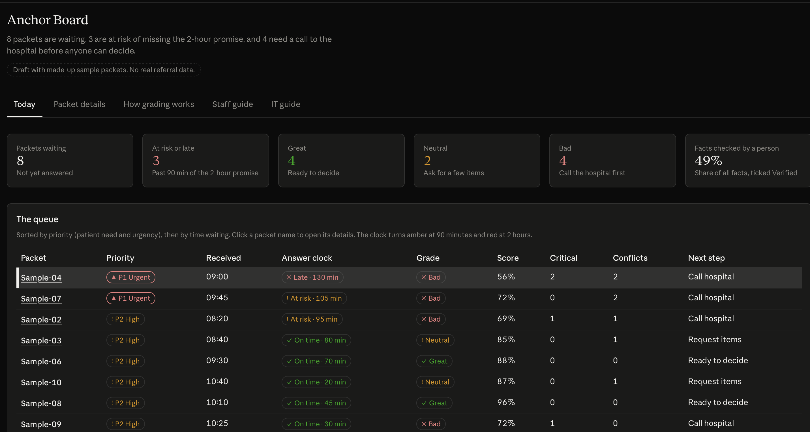
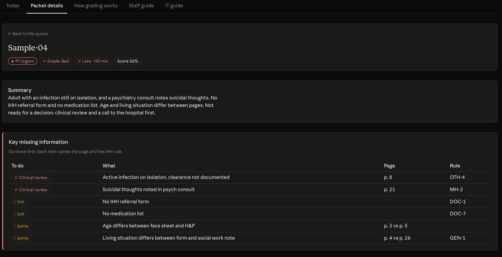
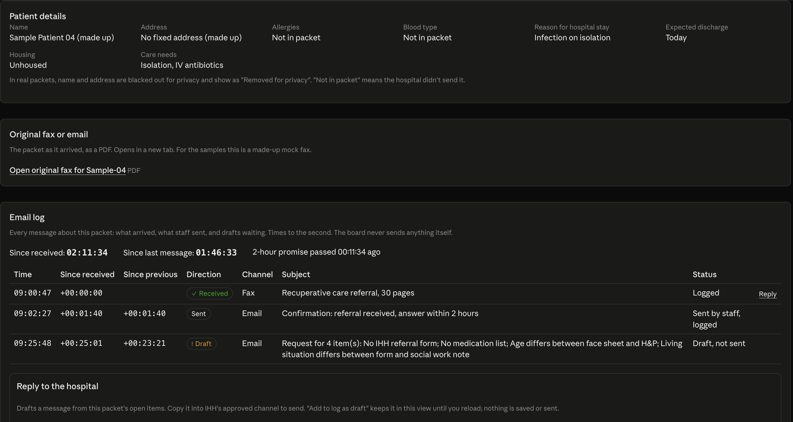

# Anchor Enterprise Dashboard 

> One sentence: who it is for and what it does.

**Team:** Team Beacon
**Members:** Alan Zhang, Nelson Navarrete, Jared Chapman, Leia Lu 
**Challenge:** Referral intake 
**Built at:** Orange County | Claude Impact Lab, October 17, 2026, with Illumination Health + Home

## The problem

An IHH referral coordinator decides whether a homeless patient who is ready to leave the hospital
can be admitted to recuperative care, and IHH promises hospitals an answer within two hours. Each
referral arrives as 15 to 35 faxed pages, often crooked or handwritten, that the coordinator reads
by hand against six pages of admission criteria, hunting for the fact deep in the chart that can
contradict the referral form. When information is missing, they have to chase the hospital for it,
and because hospitals send the same referral to several providers, a slow answer can mean the
patient is discharged to the street.

## What we built

What it does. A screenshot or a short clip helps.

**The queue.** Every waiting packet, sorted by priority and time against the 2-hour promise, with a
grade and the next step.

**One packet.** A summary, and the key missing information, each item tied to a page and an IHH
rule ID.

**Patient details and email log.** Fields the packet doesn't show read "Not in packet", there's a
link to the original fax, and a timed log of every message. Replies are drafts only: the board
never sends anything.

**Demo video:** [link]

## How Claude is used

- How we built it with Claude.
- What Claude does inside the tool when it runs, and what a person checks.

- prompting Claude to understand requirements and problems, and directing it to build a solution we wanted which was a management system to visualize the status of referral packages
- A person verifies that the information is there, the information is lined up in a way that made sense, and prompted to add information that we believe is needed

## Try it

`https://claude.ai/artifact/NVUonEKc7TRXnVU9QafCVG#packet`

## What is real and what is mocked

| Part | Status |
|---|---|
| | mocked |

## Where it gets things wrong

What we saw it miss, and what we would not trust it with yet.
There's a lot of noise or extra information, the functionality haven't been fully tested against real data. The algorithem to analyze the image and process it, is not fully tested. 

## Next steps

What it would take to pilot this. What we would do with one more week.
Working with Referral Corrdinators to polish the UI and host the database and web information on AWS.

## Data and privacy

This project uses only data from the event repo and public sources. It contains no real
patient or client information. It does not connect to any Illumination Health + Home system.

## License

[MIT](LICENSE)